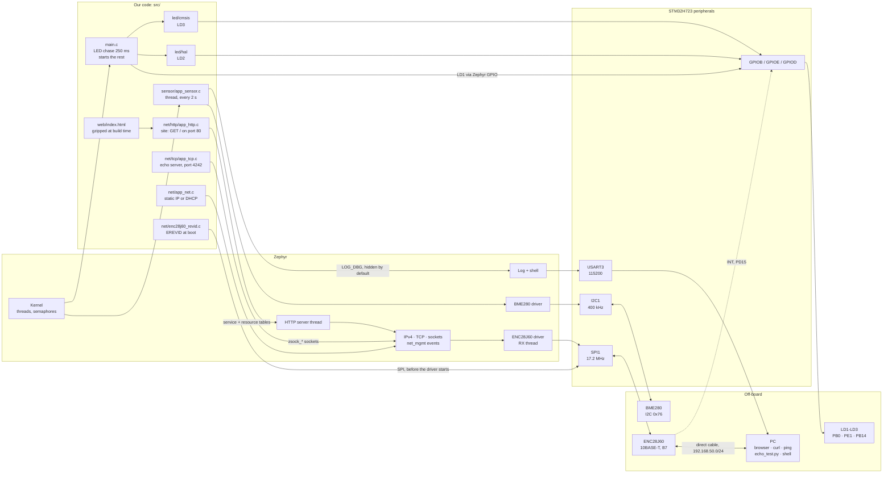
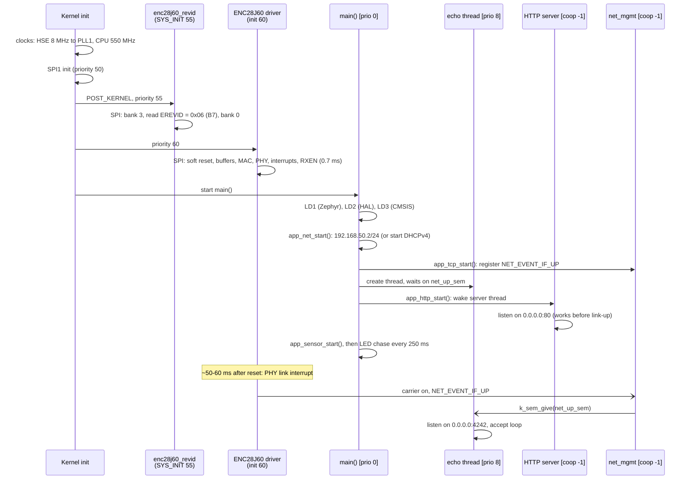
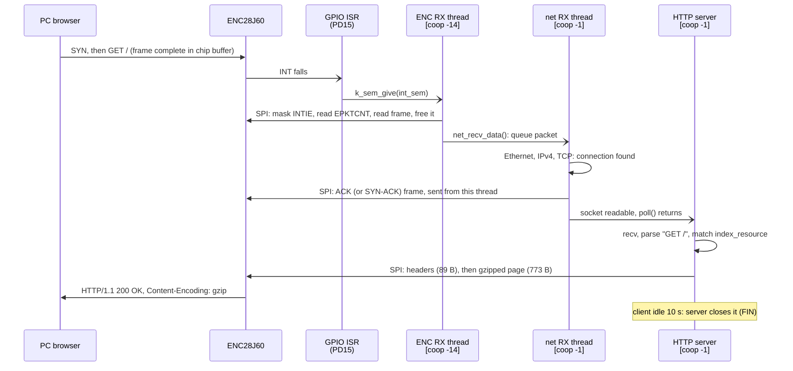
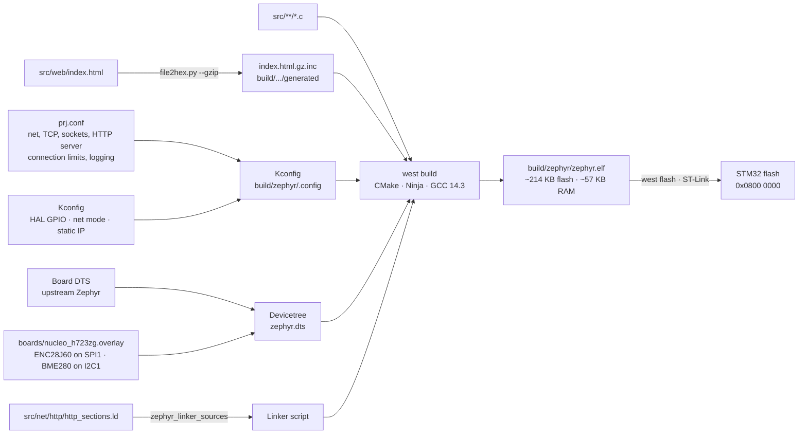

# Architecture

How the Eco-Connect gateway firmware fits together, in four views. GitHub renders the diagrams; in VS Code use the Markdown preview with the *Markdown Preview Mermaid Support* extension. Pins and clocks are in [pins-and-clocks.md](pins-and-clocks.md), the network setup and its test results in [networking.md](networking.md), every API used in `src/` in [api-reference.md](api-reference.md).

## What talks to what

Left to right: our code (`src/`) uses Zephyr's kernel, network stack and drivers, which drive the STM32 peripherals, which connect to the parts on the breadboard and to the PC. The HTTP server and the network threads belong to Zephyr; our network code only configures the address, runs the echo server and describes the web page.

DHCP mode replaces the direct cable with a router: the address then comes from its DHCP server and is logged on the console.

## What happens at boot

Zephyr initialises the drivers in priority order before `main()` runs. Our EREVID read is slotted between the SPI controller and the ENC28J60 driver, so it is the only SPI user while it runs. `main()` starts everything else without waiting: the address is set, the two servers start their threads, and the link comes up about 50-60 ms after reset.

In DHCP mode, `app_net_start()` registers an `IPV4_ADDR_ADD` callback and starts the client; the lease is logged when the router answers. The sensor thread logs a reading every 2 s at debug level (`log enable dbg app_sensor` shows them).

## Serving a page

Each lifeline is an execution context with its priority (cooperative priorities are negative and are never preempted by other threads). The interrupt handler only gives a semaphore; every SPI transfer happens in a thread. There is no network TX thread (`NET_TC_TX_COUNT=0`), so a frame is written to the ENC28J60 by the thread that sends it: the network RX thread for handshake ACKs, the HTTP server thread for its response.

Measured on the bench (captures in [evidence/network/README.md](evidence/network/README.md)): SYN answered in about 1 ms, request ACKed in about 2 ms, page delivered 50-250 ms after the request. The body waits for the PC's ACK of the header segment (likely Nagle against delayed ACK; open item). Up to 3 HTTP clients and 1 echo client are served at the same time. Ping replies follow the same receive path but are answered inside the net RX thread by the IPv4 stack.

## How the files become firmware

The devicetree describes the hardware, Kconfig picks the software features, CMake adds the generated page and the HTTP resource section, and `west build` turns everything into one image.

The bare-metal blinky in `baremetal/blinky` is separate: no Zephyr, no devicetree, its own startup code and linker script, built by `baremetal/blinky/build.sh`.
