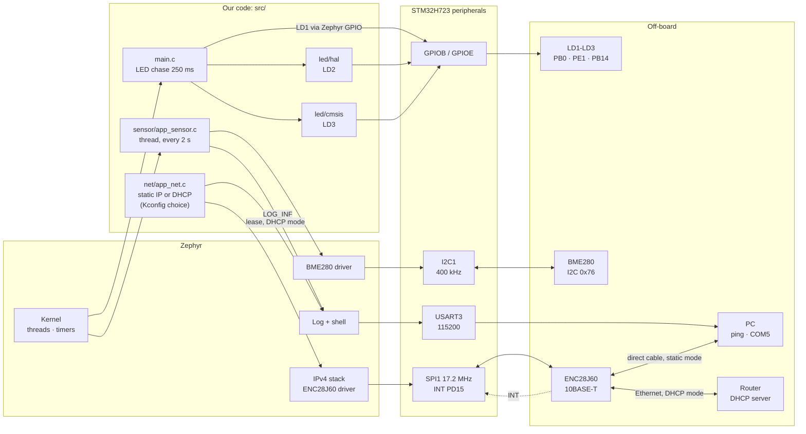
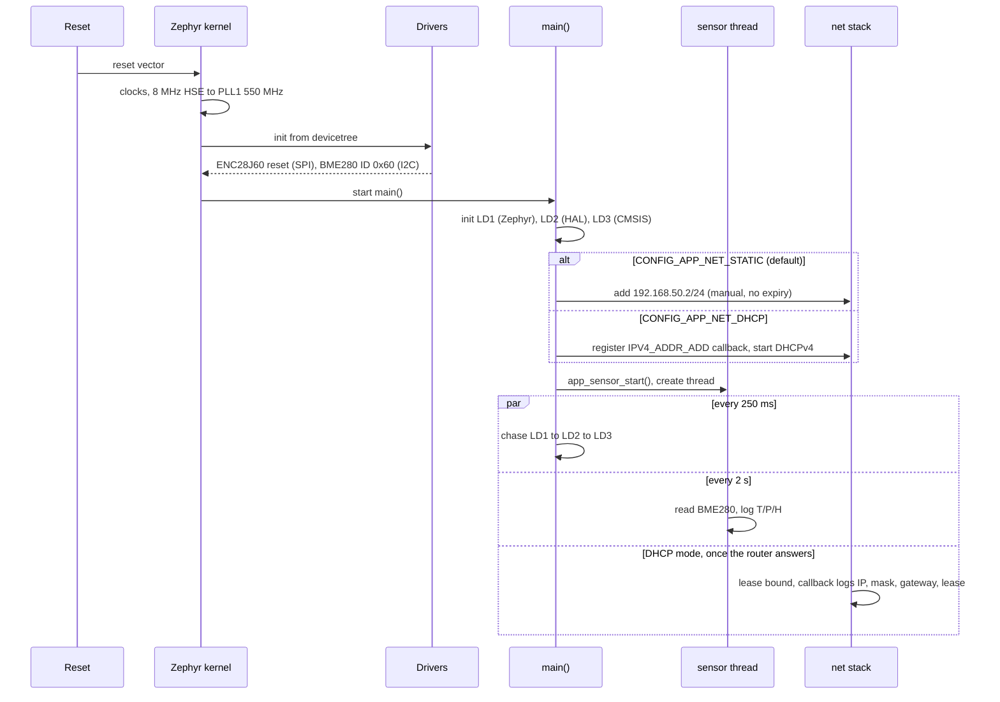
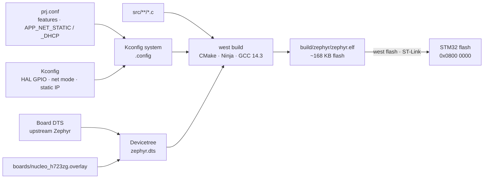

# Architecture

How the Eco-Connect gateway firmware fits together, in three views. GitHub renders the diagrams; in VS Code use the Markdown preview with the *Markdown Preview Mermaid Support* extension. Pins and clock values are in [pins-and-clocks.md](pins-and-clocks.md).

## What talks to what

Left to right: our code (`src/`) uses Zephyr's kernel and drivers, which drive the STM32 peripherals, which connect to the parts on the breadboard, the PC and the router.

## What happens when

Boot runs once; then two of our jobs share the CPU. `app_net_start()` sets up one IPv4 address, static or DHCP depending on `prj.conf`, and returns without waiting for a lease. `main()` sleeps between chase steps and the sensor thread sleeps between readings, so the kernel runs whichever one is due.

Ping replies are not in this picture because no application code runs for them: the ENC28J60 interrupt wakes the driver's receive thread, and Zephyr's IPv4 stack answers.

## How the files become firmware

The devicetree describes the hardware, Kconfig picks the software features, and `west build` turns both plus our sources into one image.

The bare-metal blinky in `baremetal/blinky` is separate: no Zephyr, no devicetree, its own startup code and linker script, built by `baremetal/blinky/build.sh`.
